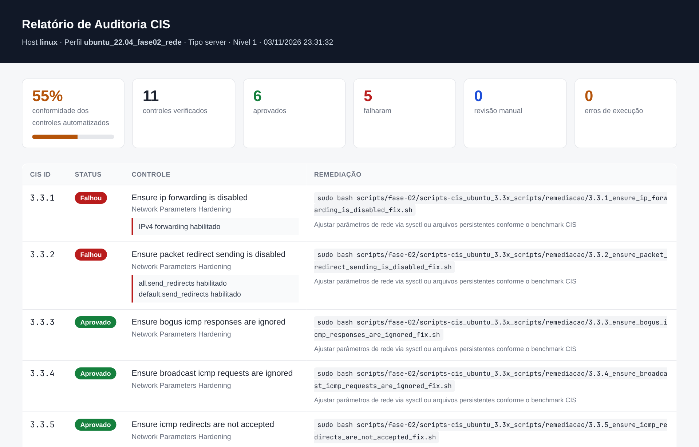
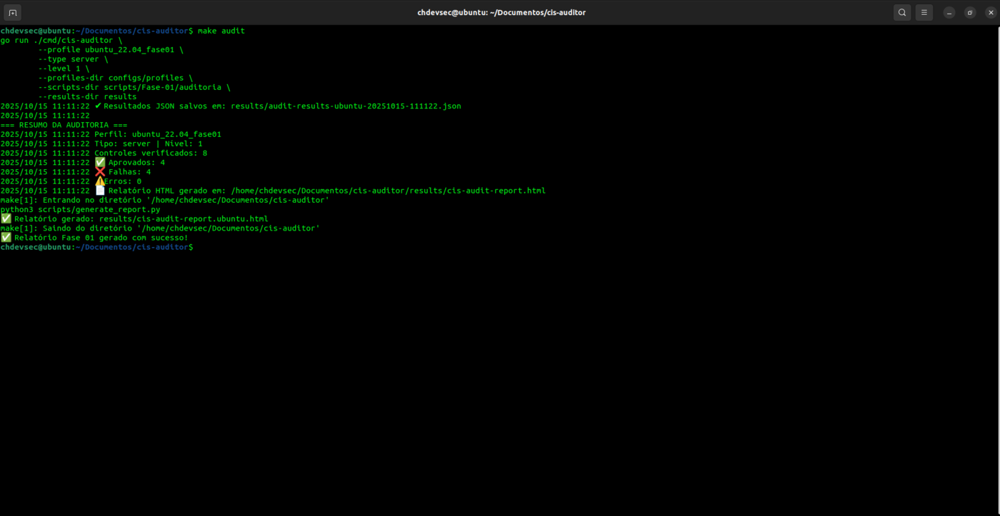
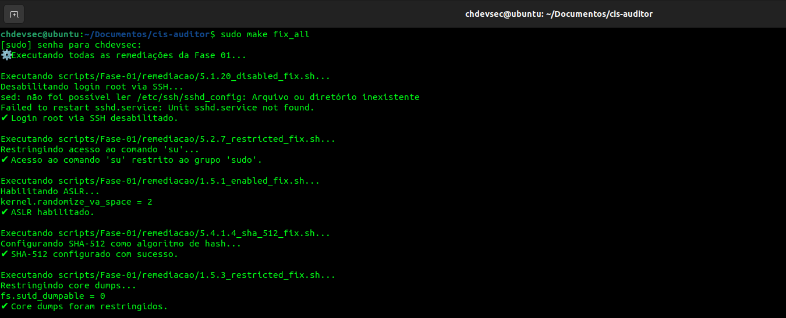
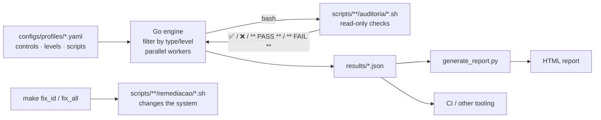

<div align="center">


# CIS Auditor

**Automated CIS Benchmark auditing and remediation for Ubuntu 22.04 LTS.**
Go engine · Bash controls · HTML/JSON reports · one `make` command.

[](https://github.com/CHDevSec/cis-auditor/actions/workflows/ci.yml)
[](https://github.com/CHDevSec/cis-auditor/releases)
[](LICENSE)
[](go.mod)
[](https://www.cisecurity.org/benchmark/ubuntu_linux)
[](docs/CONTROLS.md)

[English](README.md) · [Português](README.pt-BR.md)

</div>

---

CIS Auditor checks an Ubuntu 22.04 host against the **CIS Benchmark**, tells you exactly which controls pass or fail and why, and ships a remediation script for every control. Audits are **read-only** and safe to run on production; remediation is always a separate, explicit command.

<p align="center"></p>

## Highlights

- **52 CIS controls** across 5 profiles: bootloader, memory protection, SSH, authentication, server services, AppArmor, UFW firewall and kernel network parameters. [Full list →](docs/CONTROLS.md)
- **Audit and remediation strictly separated.** `auditoria/` scripts only read the system; `remediacao/` scripts are only run by `fix_id` / `fix_all`.
- **Parallel engine in Go.** Controls run concurrently (one worker per CPU by default) and results keep the profile order. A full profile finishes in milliseconds.
- **Four honest statuses.** `PASS`, `FAIL`, `MANUAL` (the check only collects evidence for a human to review) and `ERROR` (the script could not run).
- **Machine-readable first.** Every run writes a JSON with metadata, summary and per-control details; the HTML report is rendered from that same JSON.
- **CI-ready.** `--strict` exits with code `2` when any control fails, so it can gate a pipeline.
- **Profiles are data.** Add a control by dropping a Bash script and a YAML entry; no engine changes. Docs are generated from the profiles (`make docs`).

## Quick start

```bash
git clone https://github.com/CHDevSec/cis-auditor.git
cd cis-auditor

make help              # list every target
sudo make audit        # Phase 01 audit → results/*.json + results/cis-audit-report-*.html
sudo make audit_all    # every profile (Phase 01 + Phase 02)
```

Requirements: Ubuntu 22.04 LTS (other Debian-based systems work for most checks), Go 1.18+, Python 3.8+, Bash. Audits run without root, but some checks (e.g. `ufw status`, process names in `ss -p`) only see the full picture with `sudo`.

<p align="center"></p>

## Usage

### Audit

| Command | What it checks |
|---|---|
| `make audit` | Phase 01 — bootloader password, ASLR, core dumps, SSH root login/auth/empty passwords, `su` restriction, SHA-512 password hashing |
| `make audit_fase02_servicos` | 22 server services that should not be in use (2.1.x) |
| `make audit_fase02_apparmor` | AppArmor installed, enabled at boot, profiles enforced (1.3.x) |
| `make audit_fase02_ufw` | UFW firewall: installed, enabled, loopback, outbound, open ports, default deny (4.1.x) |
| `make audit_fase02_rede` | Kernel network parameters: forwarding, redirects, ICMP, source routing, SYN cookies… (3.3.x) |
| `make audit_fase02` / `make audit_all` | All Phase 02 profiles / everything |
| `make audit_id ID=3.3.1` | A single control, printing the raw script output |

Options for any audit target: `TYPE=workstation`, `LEVEL=2`, `RESULTS=/var/log/cis`.

### Remediate

```bash
sudo make fix_id ID=1.5.1    # apply one control's remediation
sudo make fix_all            # apply every Phase 01 remediation
```

<p align="center"></p>

> [!WARNING]
> Remediation **changes the system**. Read the script, run it on a VM or snapshot first, and audit again afterwards. In particular:
> - **UFW (4.1.x) can lock you out.** `4.1.6` denies every listening port without a rule (including SSH/22) and `4.1.7` sets *deny outgoing*. Allow your management ports (`ufw allow 22/tcp`) and decide your outbound policy **before** enabling the firewall remotely.
> - **`1.4.1` (GRUB password) is interactive** and rewrites `/etc/grub.d/40_custom`.
> - Some fixes append to config files (`/etc/sysctl.conf`, `limits.conf`); running them repeatedly adds duplicate lines.

### Reports

Each run produces `results/audit-results-<host>-<profile>-<timestamp>.json` and, through `make`, `results/cis-audit-report-<profile>.html`. To (re)render a report:

```bash
make report                                          # latest JSON in results/
python3 scripts/generate_report.py results/x.json -o report.html
```

<details>
<summary>JSON format</summary>

```json
{
  "profile": "ubuntu_22.04_fase02_rede",
  "machine_type": "server",
  "level": 1,
  "hostname": "web-01",
  "timestamp": "2026-11-03T23:31:32-03:00",
  "total": 11, "passed": 6, "failed": 5, "manual": 0, "errors": 0,
  "controls": [
    {
      "ID": "3.3.1",
      "Category": "Network Parameters Hardening",
      "Description": "Ensure ip forwarding is disabled",
      "Status": "FAIL",
      "Remediation": "Ajustar parâmetros de rede via sysctl ou arquivos persistentes conforme o benchmark CIS",
      "Details": "IPv4 forwarding habilitado",
      "FixScript": "scripts/fase-02/scripts-cis_ubuntu_3.3x_scripts/remediacao/3.3.1_ensure_ip_forwarding_is_disabled_fix.sh"
    }
  ]
}
```
</details>

### In CI

```yaml
- name: CIS baseline
  run: sudo make ci     # Phase 01 with --strict: fails the job if any control fails
```

### Running the binary directly

```bash
make build
./bin/cis-auditor --profile ubuntu_22.04_fase02_rede --type server --level 1 --strict
./bin/cis-auditor --help
```

The scripts folder comes from the profile's `scripts_dir`; `--scripts-dir` overrides it.

## How it works



An audit script prints its verdict; the engine reads it:

| Script output | Status |
|---|---|
| any line with `❌`, `✘`, `✖` or `** FAIL **` | `FAIL` (those lines and `- ` lines become the details) |
| otherwise, any line with `✅`, `✔` or `** PASS **` | `PASS` |
| no marker at all | `MANUAL` (the output is kept as evidence) |
| the script cannot be executed | `ERROR` |

A non-zero exit code is **not** an error — many checks end with a `grep` that finds nothing.

### Project layout

```
cmd/cis-auditor/        CLI entry point
internal/auditor/       engine: profile loading, parallel execution, output parsing (+ tests)
configs/profiles/       one YAML per profile (title, scripts_dir, controls)
scripts/Fase-01/        Phase 01: auditoria/ + remediacao/
scripts/fase-02/        Phase 02: services, AppArmor, UFW, network
scripts/generate_report.py   JSON → HTML report (stdlib only)
tools/gendocs/          generates docs/CONTROLS.md and the per-folder READMEs
results/                output (git-ignored)
```

## Adding a control

1. Write `scripts/<phase>/auditoria/<ID>_<name>_audit.sh` — read-only, prints `✅ …` or `❌ …`.
2. Write the matching `remediacao/<ID>_<name>_fix.sh`.
3. Add the entry to the profile YAML (`id`, `category`, `description`, `remediate`, `level`, `script_audit`, `script_fix`).
4. `make docs && make test` and open a pull request. Details in [CONTRIBUTING.md](CONTRIBUTING.md).

## Roadmap

- [ ] Remaining CIS Ubuntu 22.04 sections (filesystem/partitions, logging & auditd, cron, PAM)
- [ ] Safer UFW remediation (keep the current SSH port, configurable outbound policy)
- [ ] Idempotent remediation (no duplicate lines in `sysctl.conf` / `limits.conf`)
- [ ] Ubuntu 24.04 profiles
- [ ] Diff between two runs (drift report)

## Security

Found a problem in a check or a remediation that could weaken a system? See [SECURITY.md](SECURITY.md).

## License

[MIT](LICENSE) © Caio Henrique · [CHDevSec](https://github.com/CHDevSec)

CIS® and CIS Benchmarks™ are trademarks of the Center for Internet Security, Inc. This project is independent and not affiliated with or endorsed by CIS; control IDs and titles are referenced for interoperability. Get the official benchmark at [cisecurity.org](https://www.cisecurity.org/benchmark/ubuntu_linux).
