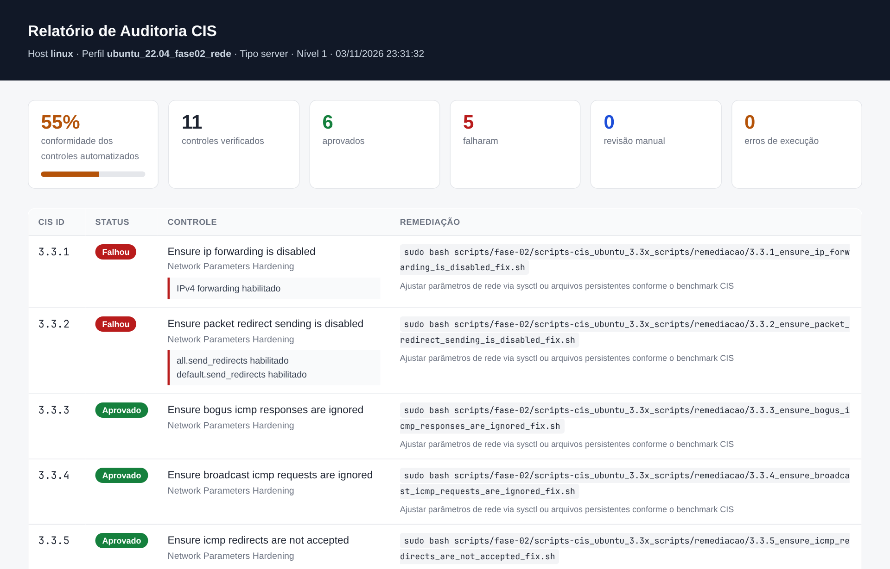
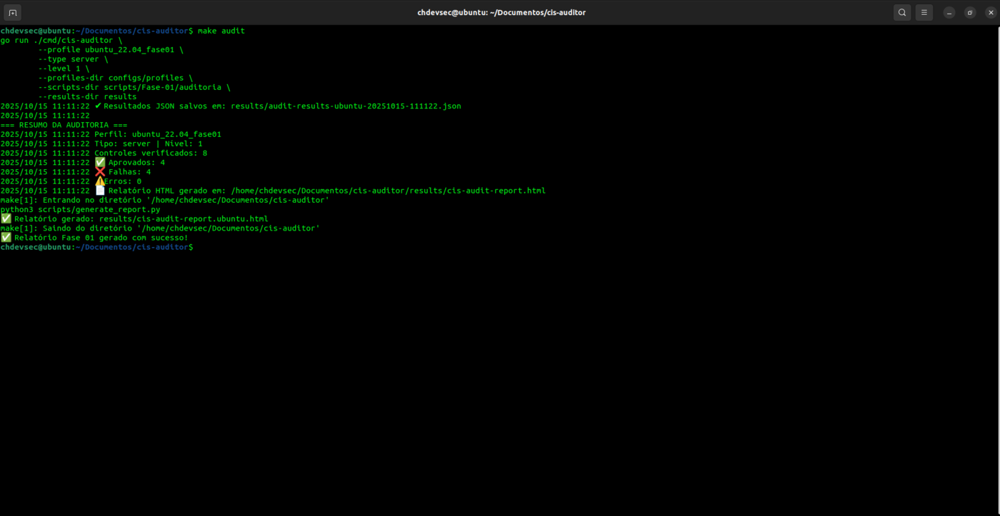
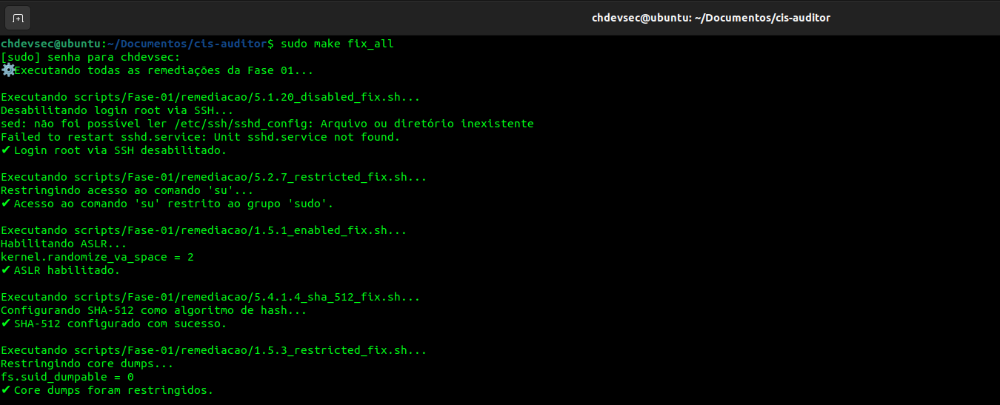
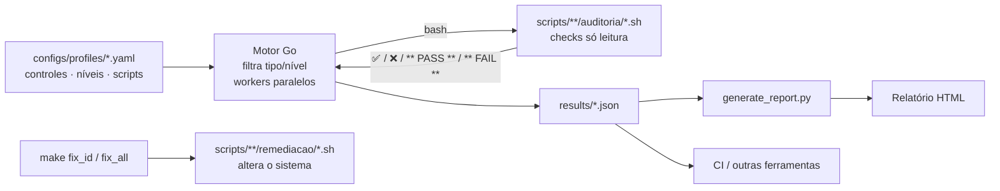

<div align="center">


# CIS Auditor

**Auditoria e remediação automatizadas do CIS Benchmark para Ubuntu 22.04 LTS.**
Motor em Go · controles em Bash · relatórios HTML/JSON · um comando `make`.

[](https://github.com/CHDevSec/cis-auditor/actions/workflows/ci.yml)
[](https://github.com/CHDevSec/cis-auditor/releases)
[](LICENSE)
[](go.mod)
[](https://www.cisecurity.org/benchmark/ubuntu_linux)
[](docs/CONTROLS.md)

[English](README.md) · [Português](README.pt-BR.md)

</div>

---

O CIS Auditor verifica um Ubuntu 22.04 contra o **CIS Benchmark**, mostra exatamente quais controles passam ou falham e por quê, e traz um script de remediação para cada controle. A auditoria é **só leitura** e pode rodar em produção; a remediação é sempre um comando separado e explícito.

<p align="center"></p>

## Destaques

- **52 controles CIS** em 5 perfis: bootloader, proteção de memória, SSH, autenticação, serviços de servidor, AppArmor, firewall UFW e parâmetros de rede do kernel. [Lista completa →](docs/CONTROLS.md)
- **Auditoria e remediação separadas de verdade.** Os scripts de `auditoria/` só leem o sistema; os de `remediacao/` só rodam com `fix_id` / `fix_all`.
- **Motor paralelo em Go.** Os controles rodam ao mesmo tempo (um worker por CPU) e o resultado mantém a ordem do perfil. Um perfil inteiro termina em milissegundos.
- **Quatro status honestos.** `PASS`, `FAIL`, `MANUAL` (o check só coleta evidência para uma pessoa revisar) e `ERROR` (o script não pôde rodar).
- **JSON primeiro.** Cada execução grava um JSON com metadados, resumo e detalhes por controle; o HTML é gerado a partir do mesmo JSON.
- **Pronto para CI.** `--strict` sai com código `2` quando algum controle falha.
- **Perfil é dado.** Um controle novo é um script Bash e uma entrada no YAML, sem mexer no motor. A documentação é gerada dos perfis (`make docs`).

## Começando

```bash
git clone https://github.com/CHDevSec/cis-auditor.git
cd cis-auditor

make help              # lista todos os alvos
sudo make audit        # Fase 01 → results/*.json + results/cis-audit-report-*.html
sudo make audit_all    # todos os perfis (Fase 01 + Fase 02)
```

Requisitos: Ubuntu 22.04 LTS (outros sistemas baseados em Debian funcionam para a maioria dos checks), Go 1.18+, Python 3.8+ e Bash. A auditoria roda sem root, mas alguns checks (por exemplo `ufw status` e o nome dos processos no `ss -p`) só enxergam tudo com `sudo`.

<p align="center"></p>

## Uso

### Auditar

| Comando | O que verifica |
|---|---|
| `make audit` | Fase 01: senha do GRUB, ASLR, core dumps, login/autenticação root e senha vazia no SSH, restrição do `su`, hash SHA-512 |
| `make audit_fase02_servicos` | 22 serviços de servidor que não devem estar em uso (2.1.x) |
| `make audit_fase02_apparmor` | AppArmor instalado, ativo no boot, perfis em enforce (1.3.x) |
| `make audit_fase02_ufw` | Firewall UFW: instalado, ativo, loopback, saída, portas abertas, deny padrão (4.1.x) |
| `make audit_fase02_rede` | Parâmetros de rede do kernel: forwarding, redirects, ICMP, source routing, SYN cookies… (3.3.x) |
| `make audit_fase02` / `make audit_all` | Todos os perfis da Fase 02 / tudo |
| `make audit_id ID=3.3.1` | Um controle só, mostrando a saída do script |

Opções em qualquer alvo de auditoria: `TYPE=workstation`, `LEVEL=2`, `RESULTS=/var/log/cis`.

### Remediar

```bash
sudo make fix_id ID=1.5.1    # aplica a remediação de um controle
sudo make fix_all            # aplica todas as remediações da Fase 01
```

<p align="center"></p>

> [!WARNING]
> A remediação **altera o sistema**. Leia o script, teste numa VM ou snapshot e audite de novo depois. Em especial:
> - **O UFW (4.1.x) pode te trancar para fora.** O `4.1.6` bloqueia toda porta aberta sem regra (inclusive SSH/22) e o `4.1.7` aplica *deny outgoing*. Libere as portas de gerência (`ufw allow 22/tcp`) e defina a política de saída **antes** de ativar o firewall remotamente.
> - **O `1.4.1` (senha do GRUB) é interativo** e reescreve `/etc/grub.d/40_custom`.
> - Algumas correções acrescentam linhas em arquivos de configuração (`/etc/sysctl.conf`, `limits.conf`); rodar de novo duplica as linhas.

### Relatórios

Cada execução gera `results/audit-results-<host>-<perfil>-<data>.json` e, pelo `make`, `results/cis-audit-report-<perfil>.html`. Para (re)gerar um relatório:

```bash
make report                                          # JSON mais recente em results/
python3 scripts/generate_report.py results/x.json -o relatorio.html
```

O formato do JSON está no [README em inglês](README.md#reports).

### No CI

```yaml
- name: Baseline CIS
  run: sudo make ci     # Fase 01 com --strict: o job falha se algum controle falhar
```

### Rodando o binário direto

```bash
make build
./bin/cis-auditor --profile ubuntu_22.04_fase02_rede --type server --level 1 --strict
./bin/cis-auditor --help
```

A pasta dos scripts vem do `scripts_dir` do perfil; `--scripts-dir` sobrescreve.

## Como funciona



O script de auditoria imprime o veredito e o motor lê:

| Saída do script | Status |
|---|---|
| alguma linha com `❌`, `✘`, `✖` ou `** FAIL **` | `FAIL` (essas linhas e as que começam com `- ` viram os detalhes) |
| senão, alguma linha com `✅`, `✔` ou `** PASS **` | `PASS` |
| nenhum marcador | `MANUAL` (a saída fica como evidência) |
| o script não pôde ser executado | `ERROR` |

Código de saída diferente de zero **não** é erro: vários checks terminam num `grep` que não encontrou nada.

### Estrutura

```
cmd/cis-auditor/        CLI
internal/auditor/       motor: perfis, execução paralela, leitura da saída (+ testes)
configs/profiles/       um YAML por perfil (title, scripts_dir, controls)
scripts/Fase-01/        Fase 01: auditoria/ + remediacao/
scripts/fase-02/        Fase 02: serviços, AppArmor, UFW, rede
scripts/generate_report.py   JSON → HTML (só biblioteca padrão)
tools/gendocs/          gera docs/CONTROLS.md e os README das pastas
results/                saída (fora do git)
```

## Adicionando um controle

1. Crie `scripts/<fase>/auditoria/<ID>_<nome>_audit.sh`: só leitura, imprime `✅ …` ou `❌ …`.
2. Crie o `remediacao/<ID>_<nome>_fix.sh` correspondente.
3. Adicione a entrada no YAML do perfil (`id`, `category`, `description`, `remediate`, `level`, `script_audit`, `script_fix`).
4. `make docs && make test` e abra um pull request. Detalhes em [CONTRIBUTING.md](CONTRIBUTING.md).

## Roadmap

- [ ] Demais seções do CIS Ubuntu 22.04 (partições, logging/auditd, cron, PAM)
- [ ] Remediação de UFW mais segura (mantém a porta SSH atual, política de saída configurável)
- [ ] Remediação idempotente (sem linhas duplicadas em `sysctl.conf` / `limits.conf`)
- [ ] Perfis para Ubuntu 24.04
- [ ] Diferença entre duas execuções (relatório de drift)

## Segurança

Achou um check ou uma remediação que pode enfraquecer um sistema? Veja [SECURITY.md](SECURITY.md).

## Licença

[MIT](LICENSE) © Caio Henrique · [CHDevSec](https://github.com/CHDevSec)

CIS® e CIS Benchmarks™ são marcas do Center for Internet Security, Inc. Este projeto é independente, sem vínculo ou endosso do CIS; os IDs e títulos dos controles são citados para interoperabilidade. O benchmark oficial está em [cisecurity.org](https://www.cisecurity.org/benchmark/ubuntu_linux).
